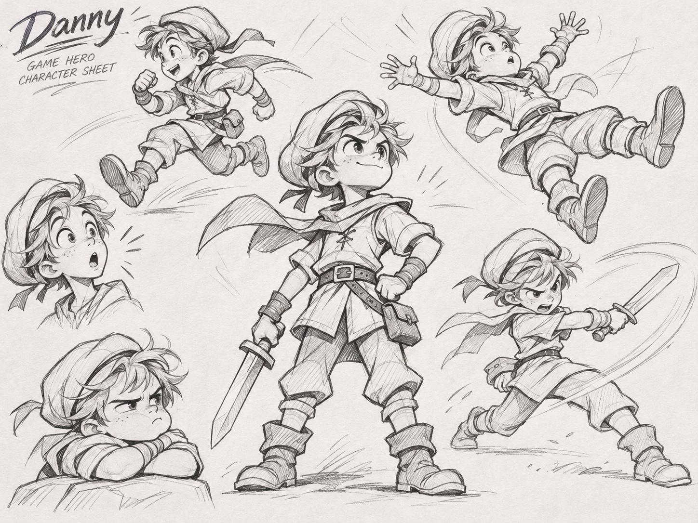

# Danny – CANONICAL CHARACTER REFERENCE SHEET

**Status: FOUNDER APPROVED · DESIGN LOCKED · 2026-11-12**

**Exact original artwork:** [DANNY_CANONICAL_CHARACTER_SHEET.png](reference/DANNY_CANONICAL_CHARACTER_SHEET.png)  
**SHA-256:** `e4adce3822c367516ae2c5d6ca3d03b426e67feace021be5f8c92eda83735fe2`  
**Dimensions:** 1448 × 1086 pixels · PNG · 3,891,402 bytes  
**Git blob SHA:** `267358ce51a5af3b234cc0b7dc937e3d4bcd824d`  
**Project:** `Joenasriani/danny-game` · **Not** the original Stickman repository.

## Locked visual identity – match the reference, do not replace it

Danny is **a boy**. This exact uploaded image, not a newly generated alternative, is the **single canonical visual reference** for his character identity.

Match the shared character design throughout all depicted poses:
- Boyish adventurer with lively, tousled hair emerging from a soft/slouched cap and trailing cap ribbon.
- Large expressive eyes, brows and face acting, a distinctive tufted fringe and subtle facial freckles.
- Short lace-front tunic with rolled sleeves, draping cape/scarf, waist belt and side pouch.
- Loose cropped trousers, fabric wraps/cuffs, weighty cuffed adventurer boots.
- Short, functional one-handed sword, with a clear silhouette in idle and attack poses.
- Hand-drawn black/grey graphite and visible pencil construction, selective crosshatching, clean negative space.
- The **same boy and costume** across the confident central hero pose, running, midair/falling, sword slash, surprised expression and grumpy/resting portrait.
- Cinematic character acting through silhouette, face, timing and believable weight, without disrupting gameplay.

Treat these as **design invariants** rather than a requirement to duplicate every incidental rough line or redraw the whole sheet as a single sprite. The original image is a concept/pose reference, not an exportable skeletal rig or an animation-ready turn-around.

## Locked production boundary

- **Phase 01:** Preserve this exact design reference and develop an animation-ready **character bible**: consistent front/side/three-quarter construction; pivot and proportion sheets; expression shapes; separated body-part artwork; sword/weapon orientation; pose and motion staging. These derivative sheets must remain faithful to the canonical artwork and still need visual review. No change to gameplay or claims of a playable redesigned Danny character during Phase 01.
- **Phase 02:** **Build the animated, playable prototype** using the approved reference: rig or draw/replace components, establish state-to-animation mapping, integrate Danny visually into one level of the existing Three.js game, test inputs, camera viewpoints, combat timing, rendering and mobile performance. The current sheet is a guide, not a ready-made game asset.
- **Phase 03:** Extend only the founder-approved prototype treatment across all sixteen levels, with complete regression and release checks.

**Protected:** Preserve the original game and 16-level mechanics, collision, movement, camera gestures, sword attack timing, sound and original Stickman repository. Do not silently alter Danny's age presentation, outfit, silhouette or expressive drawing language. Material changes to the approved design require explicit founder approval, recorded in GitHub.

## Evidence and status

- **Approved design/reference image:** LOCKED and preserved verbatim in this repository; SHA-256 checked on import.
- **Character model turnarounds and animation-ready layers:** NOT YET PRODUCED/VERIFIED.
- **Playable animated Danny rig/character:** NOT IMPLEMENTED – reserved for Phase 02.
- **Phase 01 gameplay QA:** PARTIAL/OPEN as documented in [QA_PHASE01.md](../QA_PHASE01.md).
- **Living Sketch world redesign:** NOT IMPLEMENTED.
