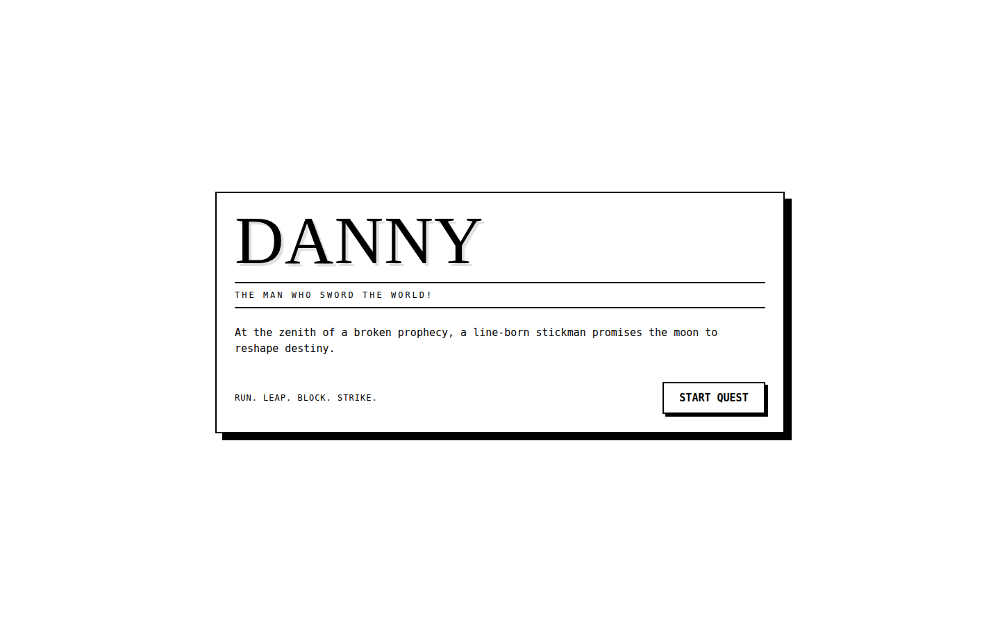
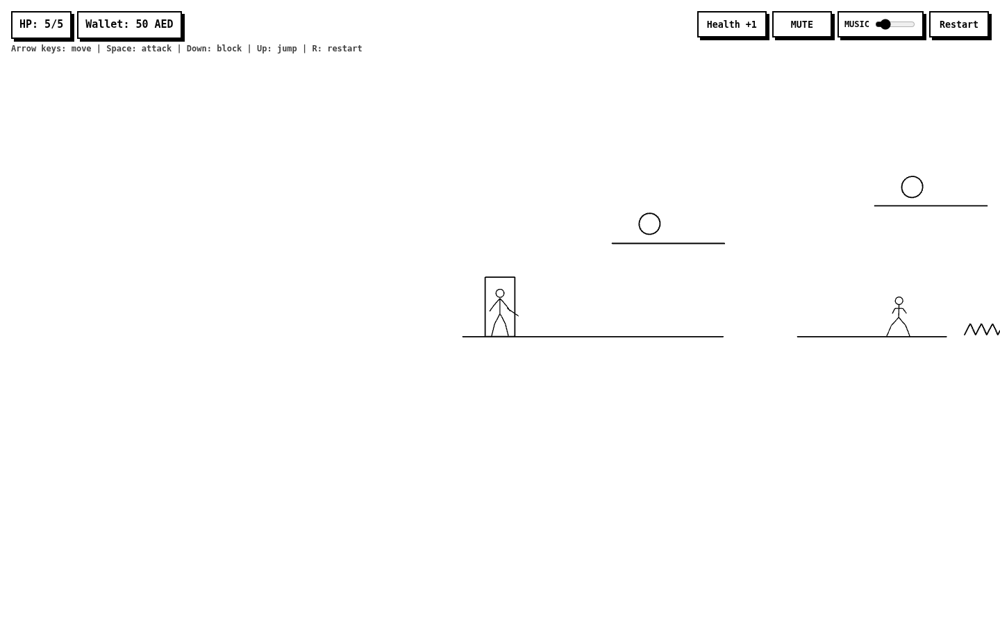
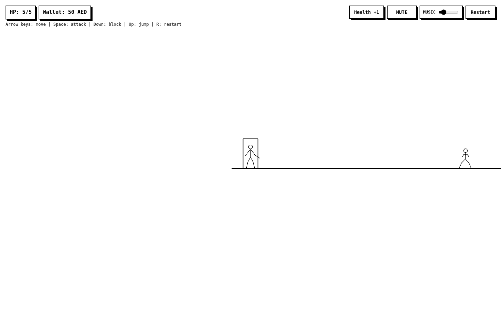
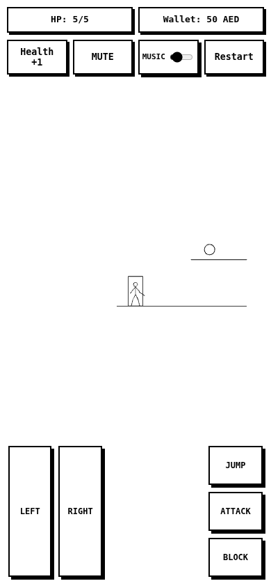
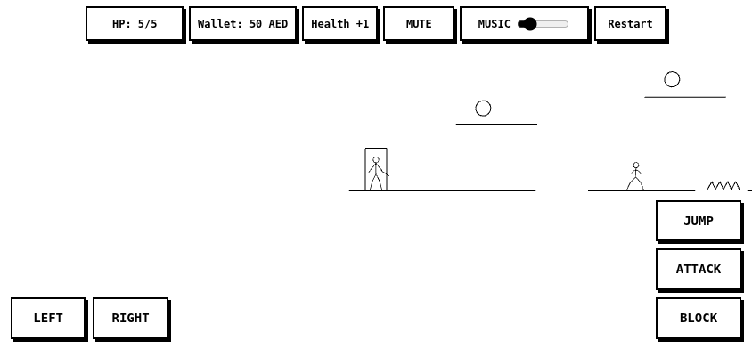
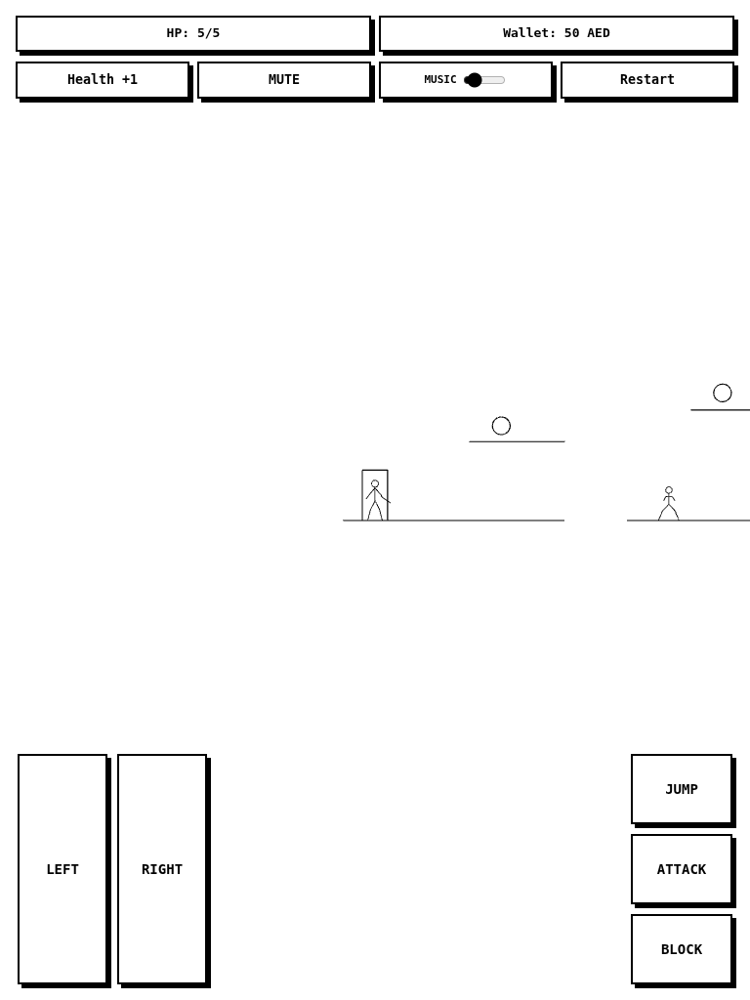

# Danny – Visual QA evidence (actual GitHub Pages game)

**Source URL:** https://joenasriani.github.io/danny-game/

**Capture method:** Headless Chromium/Playwright, GitHub Actions on Ubuntu 24.04, fresh load of the deployed game. Screenshots represent the **existing original game** before the Living Sketch redesign; they are not mockups or final Danny character designs. Portrait/landscape/tablet images are **emulated viewports**, not photographs of physical devices. The Level 4 and 16 views used test-only level selection in the isolated browser. These images do not prove normal platform traversal, audio, FPS, visual quality approval or completion of 16 levels.

## Level 1 – actual game input playthrough (Chromium)

The recorded run uses real ArrowRight and ArrowUp browser inputs against the deployed game, without player teleportation or gameplay-source edits. **It completed only Level 1** and reached Level 2; this is a computer-controlled test, **not** a human or physical-device playthrough. See [the GitHub Actions test and state trace](https://github.com/Joenasriani/danny-game/actions/runs/43228950032).

## Desktop – 1440 × 900

## Mobile portrait – emulated 390 × 844

## Mobile landscape – emulated 844 × 390

## Tablet – emulated 768 × 1024

## Danny's NEW animated character – separate playable Level 1 preview

The screenshots above depict **the original 16-level baseline**, not the new character. The new **actual live playable animated character** is at [Danny Living Sketch Level 1](https://joenasriani.github.io/danny-game/preview/danny/), and the [large character animation laboratory](https://joenasriani.github.io/danny-game/preview/danny/character-lab.html) lets you inspect all six states. Fresh screenshots recorded from the deployed animated game are available in the [successful live Chromium QA run 43236119621](https://github.com/Joenasriani/danny-game/actions/runs/43236119621/artifacts/13952381959). A screenshot is not equivalent to playing; founder visual approval and physical-device QA remain pending.

## Current acceptance boundary
Phase 01 Task 2 remains **PARTIAL / OPEN**: full natural level-by-level gameplay, real Android/iOS and tablet hardware, actual gesture quality, sound and platform reachability are not yet verified. Refer to [the QA register](../QA_PHASE01.md) for exact evidence and outstanding items.
